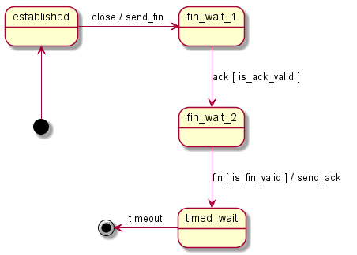

[](https://www.boost.org/LICENSE_1_0.txt)
[](https://github.com/boost-ext/sml/releases)
[](https://github.com/boost-ext/sml/actions/workflows/build_matrix.yml)
[](https://codecov.io/gh/boost-ext/sml)
[](https://godbolt.org/z/dq85hW4ab)

# SML - State Machine Language

A scalable C++14 **single-header** state machine library with no dependencies.

## Features

* Single header (`include/boost/sml.hpp`), no dependencies (not even STL or Boost)
* eUML-like transition table DSL: `src_state + event [ guard ] / action = dst_state`
* UML compliant: entry/exit actions, orthogonal regions, composite states, history, defer
* Fast compilation times, small binaries, and minimal memory footprint
* Short, readable compile-time error messages
* Testable (`testing::sm`) and observable (logger policy, runtime dispatcher)

## Quick start

Get the header:

```sh
wget https://raw.githubusercontent.com/boost-ext/sml/master/include/boost/sml.hpp
```

```cpp
#include <boost/sml.hpp>
namespace sml = boost::sml;
```

Define events, guards, and actions:

```cpp
struct release {};
struct ack { bool valid{}; };
struct fin { int id{}; bool valid{}; };
struct timeout {};

const auto is_valid = [](const auto& event) { return event.valid; };

struct sender {
  template <class TMsg>
  constexpr void send(const TMsg& msg) { std::printf("send: %d\n", msg.id); }
};

const auto send_fin = [](sender& s) { s.send(fin{0}); };
const auto send_ack = [](const auto& event, sender& s) { s.send(event); };
```

Define the state machine (TCP release example):



```cpp
struct tcp_release {
  auto operator()() const {
    using namespace sml;
    // Initial state: *initial_state
    // Transition DSL: src_state + event [ guard ] / action = dst_state
    return make_transition_table(
      *"established"_s + event<release>          / send_fin = "fin wait 1"_s,
       "fin wait 1"_s  + event<ack> [ is_valid ]            = "fin wait 2"_s,
       "fin wait 2"_s  + event<fin> [ is_valid ] / send_ack = "timed wait"_s,
       "timed wait"_s  + event<timeout>                     = X
    );
  }
};
```

Use it:

```cpp
int main() {
  using namespace sml;

  sender s{};
  sm<tcp_release> sm{s}; // pass dependencies via ctor
  assert(sm.is("established"_s));

  sm.process_event(release{});
  assert(sm.is("fin wait 1"_s));

  sm.process_event(ack{true});    // prints 'send: 0'
  assert(sm.is("fin wait 2"_s));

  sm.process_event(fin{42, true}); // prints 'send: 42'
  assert(sm.is("timed wait"_s));

  sm.process_event(timeout{});
  assert(sm.is(X)); // terminated
}
```

Compile:

```sh
# GCC / Clang
$CXX -std=c++14 -O2 -fno-exceptions -Wall -Wextra -Werror -pedantic tcp_release.cpp

# MSVC
cl /std:c++14 /Ox /W3 tcp_release.cpp
```

Output:

```text
send: 0
send: 42
```

Notes for MSVC 2015: use `state<class name>` instead of `"name"_s`, and give
lambdas explicit result types (for example `[] -> void {}`).

[Run this example on Compiler Explorer](https://godbolt.org/z/y99L50)

## Installation

SML is a single header. Pick one of the following:

* Copy [`include/boost/sml.hpp`](include/boost/sml.hpp) into your project.
* Download the [latest release](https://github.com/boost-ext/sml/releases).
* CMake with `FetchContent`:

```cmake
include(FetchContent)
FetchContent_Declare(
  sml
  GIT_REPOSITORY https://github.com/boost-ext/sml.git
  GIT_TAG v1.2.0
)
FetchContent_MakeAvailable(sml)
target_link_libraries(your_target PRIVATE sml::sml)
```

* CMake install: `cmake -B build && cmake --install build` provides the
  `sml::sml` interface target and `smlConfig.cmake` package files.

Requires C++14 or newer: Clang 3.4+, GCC 5.2+, MSVC 2015+.

## Documentation

Documentation is plain Markdown in the [`docs/`](docs/) directory and renders
directly on GitHub. No extra tooling is required.

| Document | Content |
| -------- | ------- |
| [Introduction](docs/index.md) | Motivation, design goals, supported UML features |
| [Overview](docs/overview.md) | Quick start, compilers, configuration, error messages |
| [Tutorial](docs/tutorial.md) | Events, states, guards, actions, transition tables |
| [Benchmarks](docs/benchmarks.md) | Feature comparison and benchmark results |
| [UML vs SML](docs/uml_vs_sml.md) | UML to SML mapping |
| [User Guide](docs/user_guide.md) | Concepts, state machine API, policies, utilities |
| [Examples](docs/examples.md) | Runnable examples with Compiler Explorer links |
| [FAQ](docs/faq.md) | Limitations and frequently asked questions |

Release notes are maintained as
[GitHub Releases](https://github.com/boost-ext/sml/releases).

## Examples

* [Hello World](https://github.com/boost-ext/sml/blob/master/example/hello_world.cpp) -
  [run](https://godbolt.org/z/dq85hW4ab)
* [Transitions](https://github.com/boost-ext/sml/blob/master/example/transitions.cpp) -
  [run](https://godbolt.org/z/qr8qs78Ts)
* [Orthogonal Regions](https://github.com/boost-ext/sml/blob/master/example/orthogonal_regions.cpp) -
  [run](https://godbolt.org/z/vqGbsrqM3)
* [Composite](https://github.com/boost-ext/sml/blob/master/example/composite.cpp) -
  [run](https://godbolt.org/z/5sYb9eGbe)
* [Defer and Process](https://github.com/boost-ext/sml/blob/master/example/defer_and_process.cpp) -
  [run](https://godbolt.org/z/T7YaW61en)
* [Logging](https://github.com/boost-ext/sml/blob/master/example/logging.cpp) -
  [run](https://godbolt.org/z/Tec7jz36r)
* [Testing](https://github.com/boost-ext/sml/blob/master/example/testing.cpp) -
  [run](https://godbolt.org/z/oc73h5sY8)
* [Runtime Dispatcher](https://github.com/boost-ext/sml/blob/master/example/dispatch_table.cpp) -
  [run](https://godbolt.org/z/j5bMnobY9)

See [docs/examples.md](docs/examples.md) for the complete list.

## Benchmarks

On the complex benchmark (50 events, 50 states, 50 transitions, 1M events),
SML compiles in under a second - over 60x faster than Boost.MSM-eUML - with
comparable runtime performance and 1 byte of state. Details and reproduction
steps: [docs/benchmarks.md](docs/benchmarks.md) and [`benchmark/`](benchmark/).

## Talks

* [Rise of the State Machines - C++Now 2019](https://www.youtube.com/watch?v=Zb6xcd2as6o)

## Contributing

Issues and pull requests are welcome. See
[.github/CONTRIBUTING.md](.github/CONTRIBUTING.md).

## License

Distributed under the [Boost Software License, Version 1.0](LICENSE.md).

**Disclaimer:** `[Boost::ext].SML` is not an official Boost library.
