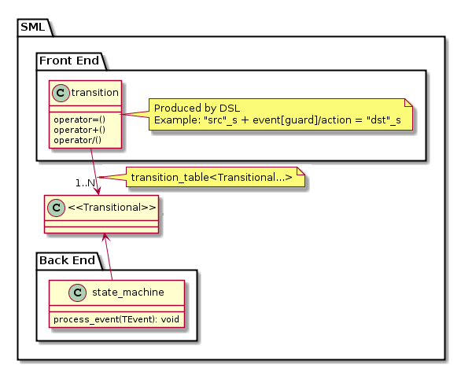

# Overview

## Quick start

Get the single header
[`boost/sml.hpp`](https://raw.githubusercontent.com/boost-ext/sml/master/include/boost/sml.hpp):

```sh
wget https://raw.githubusercontent.com/boost-ext/sml/master/include/boost/sml.hpp
```

Include the header and declare a convenient namespace alias:

```cpp
#include "boost/sml.hpp"
namespace sml = boost::sml;
```

Compile with C++14 support:

```sh
$CXX -std=c++14 ...
```

Run the tests:

```sh
git clone https://github.com/boost-ext/sml && cd sml && make test
```

See the [Tutorial](tutorial.md) and [Examples](examples.md) for complete programs.

## Dependencies

No external dependencies are required (neither STL nor Boost).

## Supported and tested compilers

* [Clang 3.4+](https://github.com/boost-ext/sml/actions/workflows/build_matrix.yml)
* [GCC 5.2+](https://github.com/boost-ext/sml/actions/workflows/build_matrix.yml)
* [MSVC 2015+](https://github.com/boost-ext/sml/actions/workflows/build_matrix.yml)

Known limitations on MSVC 2015:

```cpp
"src_state"_s + event<e> = "dst_state"_s                   // Error on MSVC 2015, ok on GCC 5+ and Clang 3.4+
state<class src_state> + event<e> = state<class dst_state> // Ok on all supported compilers
```

```cpp
const auto guard1 = [] { return true; };
state<class a> + event<e> [ guard1 ] / [](const auto& event) {}         // Error on MSVC 2015

const auto guard2 = [] -> bool { return true; };
state<class a> + event<e> [ guard2 ] / [](const auto& event) -> void {} // Ok on all supported compilers
```

## Configuration

| Macro | Description |
| ----- | ----------- |
| `BOOST_SML_VERSION` | Current version of SML (for example `1'1'13`) |
| `BOOST_SML_CFG_ENABLE_MIN_SIZE` | Opt in to the empty-SM size trick (zero-size array); disabled by default, see note below |
| `BOOST_SML_CFG_DISABLE_MIN_SIZE` | Legacy name kept for backward compatibility; the min-size trick is now disabled by default |
| `BOOST_SML_DISABLE_EXCEPTIONS` | Build with exceptions disabled (for example with `-fno-exceptions`) |
| `BOOST_SML_CREATE_DEFAULT_CONSTRUCTIBLE_DEPS` | Allow default-constructing dependencies owned by the state machine |

> **Note (min-size):** the empty state machine size optimization is **off by
> default** on GCC/Clang because the zero-length-array trick triggered undefined
> behavior at `-O2`. As a result, `sizeof(sm<...>)` for an empty state machine
> may differ from earlier releases. Define `BOOST_SML_CFG_ENABLE_MIN_SIZE` to
> opt back in.

## Exception safety

* SML does not use exceptions internally and can be compiled with `-fno-exceptions`.
* If a guard throws, the state machine stays in the current state.
* If an action throws, the state machine is already in the new state.
* Exceptions can be caught with an `exception` event in the transition table.
  See [Error handling](tutorial.md#handle-errors).

## Thread safety

SML is not thread safe by default. Thread safety can be enabled with the
`thread_safe` policy and a lock type:

```cpp
sml::sm<example, sml::thread_safe<std::recursive_mutex>> sm;
sm.process_event(event{}); // thread safe call
```

See [Policies](user_guide.md#policies-state-machine).

## Design



| Component | Description |
| --------- | ----------- |
| Front-End | Transition table domain specific language |
| Back-End | [State machine](user_guide.md#sm-state-machine) implementation |

## Error messages

SML reports misuse with short `static_assert` messages instead of deep template
errors:

* **Not configurable** - [example](https://github.com/boost-ext/sml/blob/master/test/ft/errors/not_configurable.cpp) -
  [see the compile error on Compiler Explorer](https://godbolt.org/z/zehzezMoe)
* **Not callable** - [example](https://github.com/boost-ext/sml/blob/master/test/ft/errors/not_callable.cpp) -
  [see the compile error on Compiler Explorer](https://godbolt.org/z/fb8K6q4WK)
* **Not transitional** - [example](https://github.com/boost-ext/sml/blob/master/test/ft/errors/not_transitional.cpp) -
  [see the compile error on Compiler Explorer](https://godbolt.org/z/3aWdcTanT)
* **Not dispatchable** - [example](https://github.com/boost-ext/sml/blob/master/test/ft/errors/not_dispatchable.cpp) -
  [see the compile error on Compiler Explorer](https://godbolt.org/z/984KoaP6x)
