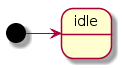
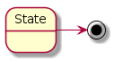
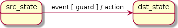
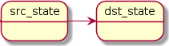

# UML vs SML

Reference: [UML 2.5 specification](https://www.omg.org/spec/UML/2.5).

## Initial pseudostate

An entry point where everything starts from.

| UML | SML |
| --- | --- |
|  | `* "idle"_s` |

## Terminate pseudostate

A state which terminates the state machine.

| UML | SML |
| --- | --- |
|  | `sml::X` |

## External transition

Conditionally updates the current state.

| UML | SML |
| --- | --- |
|  | `"src_state"_s + event [ guard ] / action = "dst_state"_s` |

## Anonymous transition

A transition without a trigger (event).

| UML | SML |
| --- | --- |
|  | `"src_state"_s = "dst_state"_s` |
